# 👋 Olá! Eu sou Pedro Mesquita

### 👨🏽‍💻 Estudante de Tecnologia | Desenvolvedor em formação

Sou estudante da área de tecnologia, interessado em desenvolvimento de software, programação e inovação. Estou sempre buscando aprender novas tecnologias, desenvolver projetos práticos e aprimorar minhas habilidades como desenvolvedor.

---

### 🚀 Sobre mim

- 🎓 Estudante de Sistemas de Informação.
- 💻 Interessado em **Desenvolvimento Fullstack**.
- 📚 Atualmente aprofundando meus conhecimentos em programação e desenvolvimento web.
- 🛠️ Gosto de aprender na prática, desenvolvendo projetos e resolvendo problemas.
- 🎯 Meu objetivo é evoluir constantemente e construir soluções utilizando tecnologia.

#

### 🧰 Linguagens e Ferramentas

  
  
  
  
  
  
  
  
  
  
  

###

<h2 align="left">💻 Minhas Contribuições</h2>

  <picture>
    <source media="(prefers-color-scheme: dark)" srcset="https://raw.githubusercontent.com/PedroMesquitaCode/PedroMesquitaCode/output/pacman-contribution-graph-dark.svg">
    <source media="(prefers-color-scheme: light)" srcset="https://raw.githubusercontent.com/PedroMesquitaCode/PedroMesquitaCode/output/pacman-contribution-graph.svg">
    
  </picture>

###

  
  
  
  

